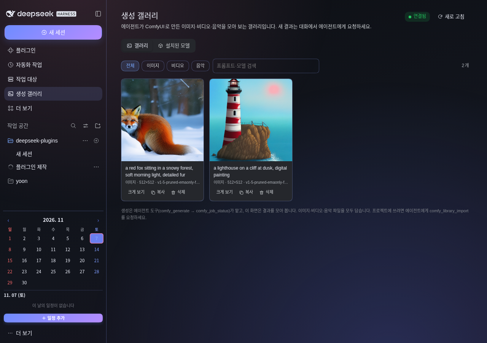
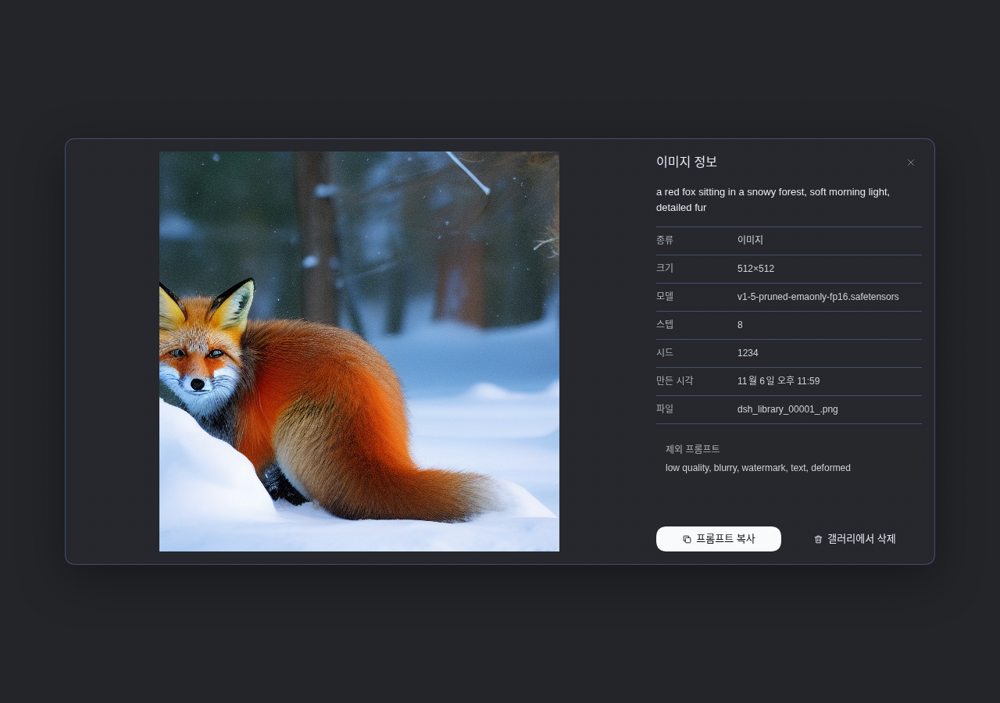
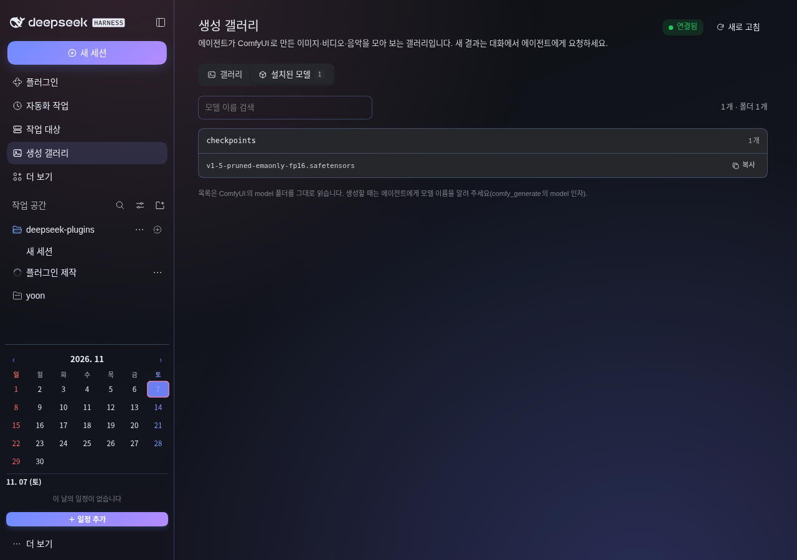
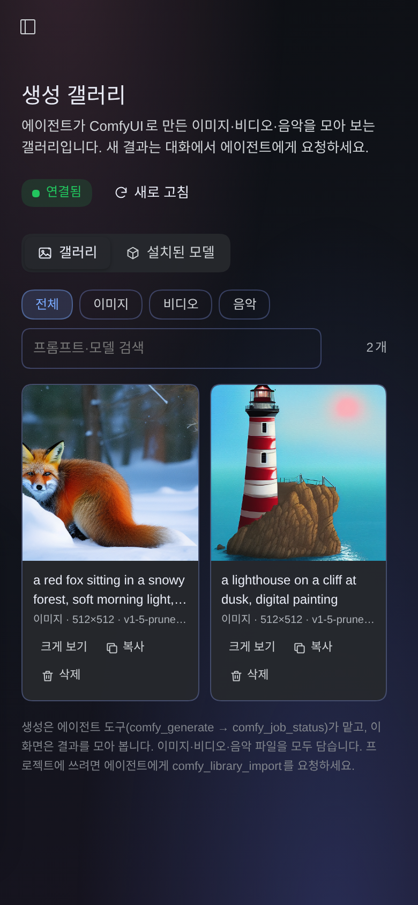

# deepseek-comfy-library (생성 갤러리)

DeepSeek Harness에 **ComfyUI 갤러리 · 에이전트 도구**를 한 플러그인으로 더한다.
사이드바의 `자동화 작업 · 작업 대상 · 생성 갤러리 · 더 보기` 순서에서 `생성 갤러리`를 누르면
에이전트가 만든 이미지·비디오·음악을 모아 보는 화면이 열린다. **생성 폼은 없다** — 생성은
대화에서 에이전트가 도구를 호출해 처리한다.

> A DeepSeek Harness plugin that turns ComfyUI into an agent-driven gallery: browse generated
> images, video, and audio, see the models installed on the server, and let the agent generate,
> search, and import assets through tools. UI is Korean by default with English fallback.



## 설치

이 저장소가 곧 DSH 플러그인 패키지다. `web` 프로필에 설치한다.

```bash
git clone git@github.com:ByungHyun21/deepseek-comfy-library.git
cd deepseek-comfy-library
npm install --omit=dev
```

그다음 `plugin_manager` 의 `install_bundle` 로 이 디렉터리를 설치하고,
`include:deepseek-comfy-library` 를 활성화한다. 설치는 `web` 프로필 전체에 적용된다.

- 요구 사항: Node.js 22.19 이상, DSH 0.2.x, HTTP API 가 열린 ComfyUI
- 설정 위치: **플러그인 → 생성 갤러리 보기 → 생성 갤러리 설정**

## ComfyUI 연결

설정에서 주소를 넣고 `연결 테스트`를 누르면 ComfyUI 버전·GPU·대기열·체크포인트가 바로 보인다.

- 상시 SSH 터널: `http://127.0.0.1:8188` (원격 ComfyUI 가 127.0.0.1 에만 열려 있을 때)
- 같은 LAN: `http://192.168.0.36:8188` (ComfyUI 가 LAN 에 열려 있을 때만)

터널은 호스트에서 `systemctl --user status comfy-tunnel.service` 로 확인한다.
이 플러그인은 터널을 직접 만들지 않는다.

## 화면

화면은 위쪽 탭으로 **갤러리**와 **설치된 모델**을 나눈다.

- **갤러리**: 미디어 종류 필터 `전체 · 이미지 · 비디오 · 음악`, 프롬프트·모델 검색, 새로 고침,
  15초 자동 갱신. 에이전트가 방금 만든 결과도 바로 보인다. 항목 카드에는 종류·크기·모델·시각이 붙는다.
- **자세히 보기**: 썸네일을 누르면 종류에 맞는 뷰어가 열린다. 이미지는 확대, 비디오는 재생,
  음악은 오디오 플레이어. 프롬프트·모델·스텝·시드·파일명과 `프롬프트 복사`·`삭제`가 함께 있다.
- **설치된 모델**: ComfyUI 의 `/models` 폴더를 그대로 읽어 `checkpoints · loras · vae · diffusion_models …`
  별로 파일 목록과 개수를 보여 준다. 이름 검색과 이름 복사가 된다.
- **새 이미지 만들기**: 화면이 아니라 대화에서 한다. 예: “ComfyUI로 해질녘 등대 이미지를 만들어줘”.
- 결과 파일은 `$DSH_HOME/comfy-library/media` 에 내려 받고 `index.json` 에 남는다.
  ComfyUI `/history` 가 정리되어도 갤러리는 유지된다.

## 원격 라이브러리 모드 (mode: remote)

여러 기기에서 같은 갤러리를 볼 때, 미디어를 기기마다 복제하지 않고 **한 호스트만 저장소**로
쓰는 모드다. 데스크톱 앱에서는 보통 이 모드로 붙인다.

- 정본은 원격 호스트(`remoteSshTarget`)의 `remoteDir`(`~/.dsh/comfy-library`) 하나뿐이다.
- 이 PC는 SSH 로 그 `index.json` 을 읽어 목록·썸네일·삭제를 중계한다. 인덱스는 TTL 동안
  메모리에만 캐시하고 **로컬에 복제하지 않는다**.
- 썸네일·뷰어 재생은 SSH 로 받은 임시 파일을 흘려보내고 바로 지운다. 화면에는 원격 파일이
  그대로 보이지만 이 PC에는 사본이 남지 않는다.
- 파일이 실제로 필요할 때(프로젝트 작업)만 `comfy_library_import` 로 대상 경로에 내려받는다.
- 생성은 그대로 에이전트 도구가 맡는다. 결과 원본은 ComfyUI 호스트가, 라이브러리 사본은
  원격 DSH 호스트가 보관한다.
- 삭제는 원격 `index.json` 을 고친다. 로컬 모드와 같은 규칙으로 `deleted` 자리표시자를 남겨
  동기화가 되살리지 못하게 하고, 미디어 파일을 지운다.
- 인증은 SSH 키다(`BatchMode=yes`). Homegate 쿠키나 토큰을 따로 다루지 않는다.

설정(플러그인 → 생성 갤러리 설정):

| 필드 | 값 예시 |
|---|---|
| 갤러리 저장 방식 | `remote` |
| 원격 SSH 대상 | `yoon@192.168.0.35` |
| 원격 라이브러리 경로 | `~/.dsh/comfy-library` |

SSH 는 미리 키 인증이 되어 있어야 한다. 확인: `ssh yoon@192.168.0.35 cat ~/.dsh/comfy-library/index.json`







## 에이전트 도구

| 도구 | 하는 일 |
|---|---|
| `comfy_status` | 연결·버전·GPU·대기열·체크포인트 확인, `mode`·원격 상태 함께 보고 |
| `comfy_generate` | txt2img 제출, `promptId` 즉시 반환 |
| `comfy_job_status` | 대기/실행/완료 확인. 로컬 모드면 결과를 갤러리에 저장, 원격 모드면 파일명·뷰 URL만 보고(사본 없음) |
| `comfy_library_search` | 프롬프트·모델·파일명으로 검색, `kind` 로 이미지/비디오/음악 필터 |
| `comfy_library_import` | 갤러리 항목(`id`) 또는 방금 끝난 작업(`promptId`)을 프로젝트 경로로 내려받기 |
| `comfy_library_delete` | 갤러리 항목 삭제(인덱스 tombstone + 미디어 제거). 원격 모드면 원격 호스트에서 지운다 |

에이전트는 `comfy_generate` → `comfy_job_status` → `comfy_library_import` 순서로
새 프로젝트에 쓸 이미지를 만들고 가져올 수 있다. 원격 모드에서는 `promptId` 만으로도
내려받을 수 있어, 원격 인덱스 동기화(최대 45초)를 기다리지 않아도 된다.

## 설계 메모

- 라이브러리 인덱스가 원본이다. ComfyUI 는 실행기일 뿐이고 결과 보관은 DSH 쪽이 맡는다.
- 삭제한 항목은 `index.json` 의 `deleted` 자리표시자로 남는다. 그래야 다음 동기화가 ComfyUI
  history 에서 같은 파일을 다시 가져와 되살리지 않는다.
- 결과 수집은 history 의 `images`·`gifs`·`videos`·`audio` 배열을 모두 본다. 확장자와 출력 배열로
  `image`·`video`·`audio` 를 가른다. 같은 파일이 두 배열에 겹치면 비디오/오디오 쪽을 따른다.
- 모델 탭은 `/models` 폴더 중 가중치 파일(`.safetensors·.ckpt·.pt·.pth·.bin·.gguf·.onnx`)만 보여 준다.
  `configs`·`custom_nodes` 처럼 모델이 아닌 폴더는 목록에서 뺀다.
- 미디어 라우트는 `Range` 요청을 받아 206 으로 조각을 보낸다. 비디오·음악 재생이 파일 전체를
  메모리에 올리지 않는다.
- 원격 모드의 SSH 출력은 파이프가 아니라 임시 파일로 받는다(일부 실행 환경의 파이프 제한 회피).
  미디어는 스트리밍 직후 임시 파일을 지우므로 이 PC에 사본이 남지 않는다.
- 원격 삭제는 `python3` 한 줄 스크립트를 base64로 감싸 실행한다. 셸 따옴표·경로 삽입 문제를 피한다.
- 생성 그래프는 API 포맷의 고정 SD1.5/SDXL 공통 txt2img 다. `SaveImage` 노드 접두사는 `dsh_library`.
- 파일 복사는 경로를 그대로 받는다. 작업 공간 밖 경로는 사용자가 지정한 경우에만 쓴다.
- 요청은 `webServer` prefix 라우트 `/comfy-library` 아래에 있고, Homegate 로그인 쿠키 뒤에 있다.

## 개발

```bash
npm test        # 구문 검사 + 단위 테스트 (node:test)
```

## 저장소

- GitHub: <https://github.com/ByungHyun21/deepseek-comfy-library>
- npm 패키지명: `deepseek-comfy-library`
- 라이선스: MIT
